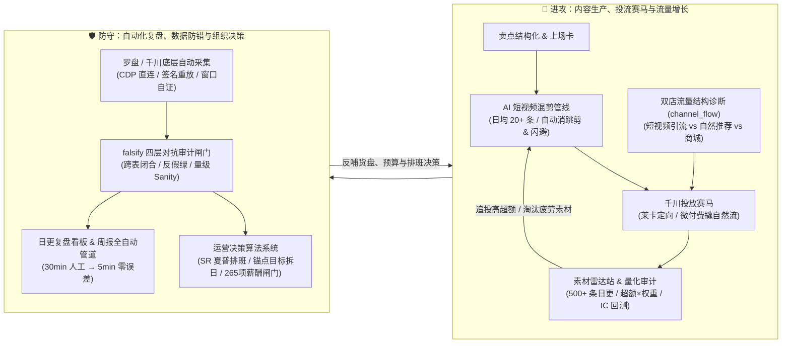

# AI-Native E-Commerce Growth & Decision Systems — Portfolio

> **懂全盘生意的 AI 原生电商操盘手**：深耕运动户外（跑步服饰）与女装赛道，既操盘过千万向亿级跃迁的品牌店播、双 11 战役与千川投流，也独立用代码把**「AI 短视频混剪生产 → 双店流量结构诊断 → 千川素材雷达 → 经营复盘自动化 → 排班与薪酬闸门」**落地成日更生产级系统。

**English tagline:** AI-native e-commerce operator & workflow builder. Led multi-store Douyin brand growth (¥42.9M Q1 GMV, ¥12M Double-11, GMS fee ratio 33% → 26%) while engineering end-to-end production systems for AI video generation (20+ clips/day), channel traffic diagnostics, quantitative creative radar, and adversarial data verification (`falsify`).

---

## 全链路经营与 AI 基建全景图

把日常店铺经营拆为**「进攻（拿流量、出爆款素材、提转化）」**与**「防守（锁口径、控费比、稳分钱）」**两条闭环：



---

## 核心实战案例（6 个脱敏生产级系统）

所有案例均来自我在抖音品牌电商（运动户外 / 服饰）一线操盘的真实生产环境，背后的 **500+ 篇带验证命令的变更记录、240+ 个生产脚本与线上看板** 支持面试当面演示：

### 一、增长与内容引擎（怎么多赚钱、快出片、找准流量缺口）

| # | 实战系统 | 解决的经营痛点 | 落地方案与核心经营结果 |
|---|---------|--------------|---------------------|
| **1** | **[AI 短视频混剪管线与双店流量诊断](case-studies/06-ai-video-and-traffic-engine.md)** | 编导剪辑产能慢、口播卖点与画面脱节；双店矩阵不知道流量差在哪 | 搭建「卖点证据绑定 + 自动消跳剪/BGM闪避/响度规整」混剪管线，支撑 **日均 20+ 条** 产出，带动短视频消耗 **+70%**、投放 ROI **5.29**；日更拆解双店 `channel_flow` 补齐渠道漏斗缺口 |
| **2** | **[千川素材雷达站与量化追投系统](case-studies/03-material-radar-quant.md)** | 单日 ROI 尖峰噪声极大，投手凭感觉追投老素材、新素材冷启动死锁 | 每日自动抓取全量 500+ 条素材，按「超额 × 权重」排序并配 CTR 疲劳早警 + eCPM 三因子短板定位；引入 **因子 IC 审计与前瞻账本回测**，防止把随机噪声当爆款信号 |

### 二、经营复盘与组织决策基建（怎么少亏钱、零算错、高人效）

| # | 实战系统 | 解决的经营痛点 | 落地方案与核心经营结果 |
|---|---------|--------------|---------------------|
| **3** | **[周报与日常复盘全自动化管道](case-studies/01-weekly-report-pipeline.md)** | 运营每天花数小时跨后台拉表算账，易列错位、易被平台滚动窗静默篡改口径 | 打通「采集 → 窗口自证 → 表头自适应解析 → 19 张飞书表与门户上线」全管道，单份周报 **20–30min 压至 5–8min**；根治平台滚动窗钳位导致的 **11% 口径偏差** |
| **4** | **[falsify 经营数据对抗审计体系](case-studies/02-falsify-audit-system.md)** | 报表作者自查流于形式，脏数据或错分母直接误导老板砍错预算、归因反转 | 建立「生产与复核异位（默认它错）」机器闸门：实战拦下 **跨表口径混用（差 13.5%）**、**脏 ROI 上线（误报 1.64× 修正为 1.16×）** 及 **大场流量断崖归因反转** |
| **5** | **[店铺运营决策系统（排班/目标/薪酬）](case-studies/05-ops-decision-systems.md)** | 黄金班次靠印象分配惹争议、月目标均摊失真、月底算提成反复扯皮 | **主播排班**：将夏普比率（SR）移植为「同时段控制残差超额」排序 + 疲劳率约束；**目标拆日**：大场硬锚点 + 节奏权重等比闭合；**月度薪酬**：**265 项机器重算闸门**清零才打款 |
| **6** | **[自研直播复盘桌面端与可靠性工程](case-studies/04-llm-client-product-falsify.md)** | 直播分钟级数据与逐字稿复盘慢；AI 客户端遇接口超时/额度耗尽易卡死或空耗成本 | 独立开发 Rust Tauri + LLM 桌面复盘工具，构建「错误契约表 + 32 例故障注入矩阵」，当场抓出并根治 **402 额度耗尽死循环重试 3 轮（浪费 12 次调用）** 的线上隐患 |

---

## 关键经营与工程指标速览

- **¥4,290 万 / ¥1,200 万**：操盘品牌 Q1 GMV（逼近上年全年）与双 11 全周期 GMV（同比 **+384%**），GMS 综合费比由 **33% 压降至 26%**
- **日均 20+ 条 / ROI 5.29**：AI 短视频工作流规模化产出，推动短视频千川消耗增长 **70%**；S 级越野赛事直播单场场观 **50 万+**
- **20–30 分钟 → 5–8 分钟**：全自动周报与多源数据对账管道，彻底解放运营手工拉表时间
- **13.5% 与 11%**：机器闸门实战拦截的跨表口径混用偏差（成交 vs 支付）与平台滚动窗静默钳位偏差
- **1.64× → 1.16×**：拦截列错位脏 ROI（假 10.79 vs 真 7.58），避免误砍核心店铺投放预算
- **265 项 / 32 例**：月度工资表全量机器重算闸门（0 Must Fix 放行打款）与客户端故障注入组合测试矩阵

---

## 方法论签名：为什么我坚持做「机器闸门（falsify）」？

在电商团队里，最贵的成本不是写脚本的时间，而是**「拿着算错的数据去做投流、砍品和分钱决策」**。
大多数团队的数据复核是作者自查；我的原则是**「确定性约束交给程序，判断留给操盘手」**：

1. **生产与复核异位**：生成报表/看板时追求效率，机器闸门复核时默认它有错（核对分项加总闭合、源文件值一致、时间窗口自证、有界指标量级）。
2. **问题分级（Cutline）**：区分 **Must Fix**（会导致错误经营判断，清空前绝不发群/上线）与 **Known Debt**（已知非阻塞问题，带触发条件跟踪），拒绝“表面全绿”的虚假安全感。
3. **护栏自检（Selftest）**：每条机器检查都配历史真实事故注入测试——一条无法被证明会翻红报警的检查，只是注释，不是护栏。

---

## 免安装直接看：机器闸门拦截实战演示

仓库内置了零依赖演示脚本 [`demo/falsify_report_gate.py`](demo/falsify_report_gate.py)（Python 3.8+ 标准库直接运行），浓缩了四次真实生产事故的拦截逻辑。无需克隆仓库，下面是直接运行的真实终端输出：

### 1. 拦截一份带有「假绿（文档说修了 ROI，实际看板未更新）」的周报
```text
$ python demo/falsify_report_gate.py

falsify_report_gate — 对抗审计演示（默认样例含一个假绿 bug）
检查族：
  C1  跨表闭合（分项加总=汇总=源）   <- 事故：口径混用差 13.5%
  C2  量级 sanity（有界指标区间）    <- 事故：CTR 1041% 列错位
  C3  宣称 vs 产物（反假绿）         <- 事故：ROI 说修了没修（10.79 vs 7.58）
  C4  窗口自证（展示窗=请求窗）      <- 事故：滚动窗钳位偏差 11%

Verdict: BLOCK — Must Fix 1 条，清空前不许发：

  [C3][Must Fix] 宣称「ROI 已修正为 7.58」但产物仍是 10.79——文档说修了、产物没重建（假绿）
```

### 2. 运行 `--selftest` 注入 4 个历史真实 Bug，验证每道闸门都能准确咬人
```text
$ python demo/falsify_report_gate.py --selftest

selftest: 干净基线 PASS（0 误报）
selftest: [OK] 口径混用：支付口径 93000 被当成交口径写进汇总 -> C1 咬人
selftest: [OK] 列错位：订单数 10.41 落进 CTR 槽（1041%）    -> C2 咬人
selftest: [OK] 假绿：宣称已修，产物仍是脏 ROI 10.79          -> C3 咬人
selftest: [OK] 窗口钳位：周窗口被换成 rolling-7d             -> C4 咬人
SELFTEST_OK
```

---

*注：本仓库为脱敏展示版（已隐去具体店铺后台敏感凭证、主播真名与部分未公开绝对值）。面试可现场演示线上实时看板、千川素材雷达站、AI 混剪成片管线与完整代码库。*
